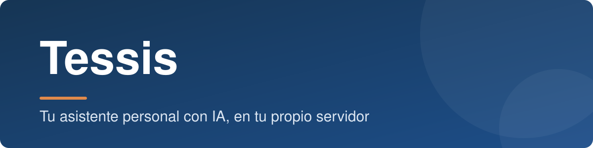
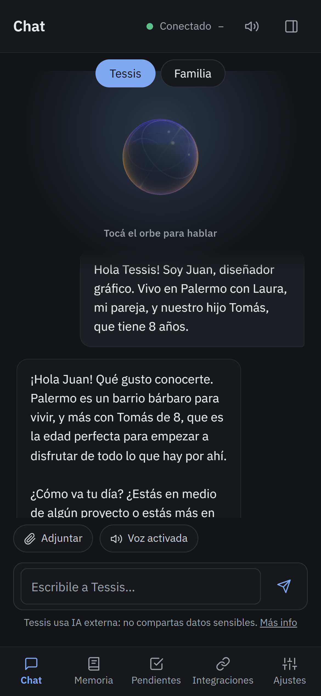
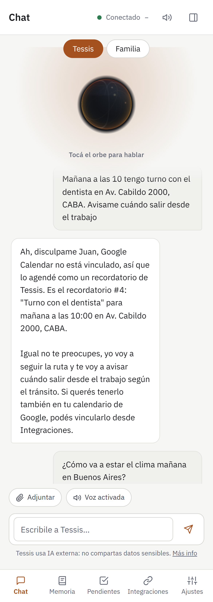
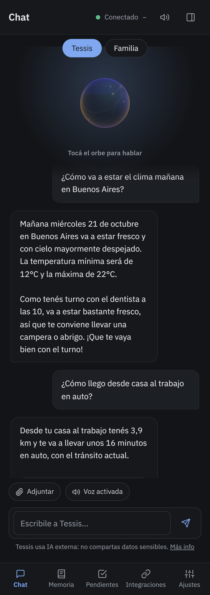
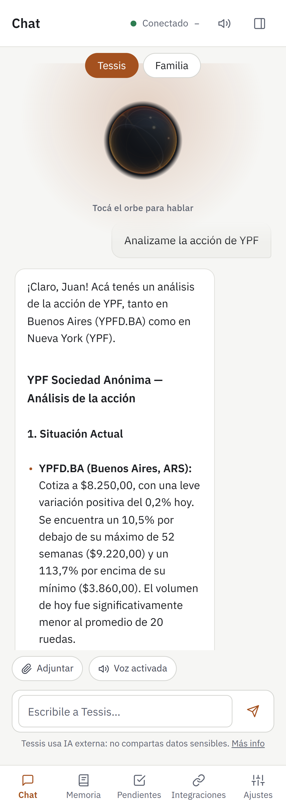
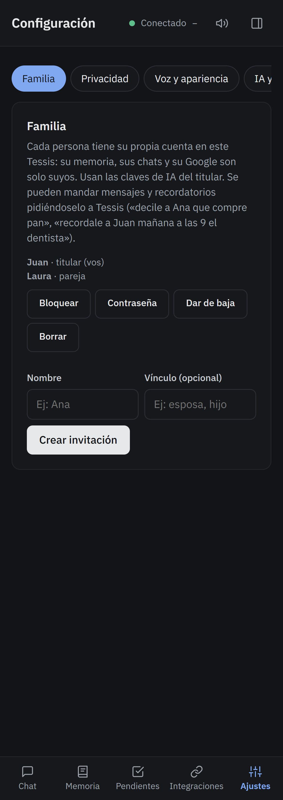
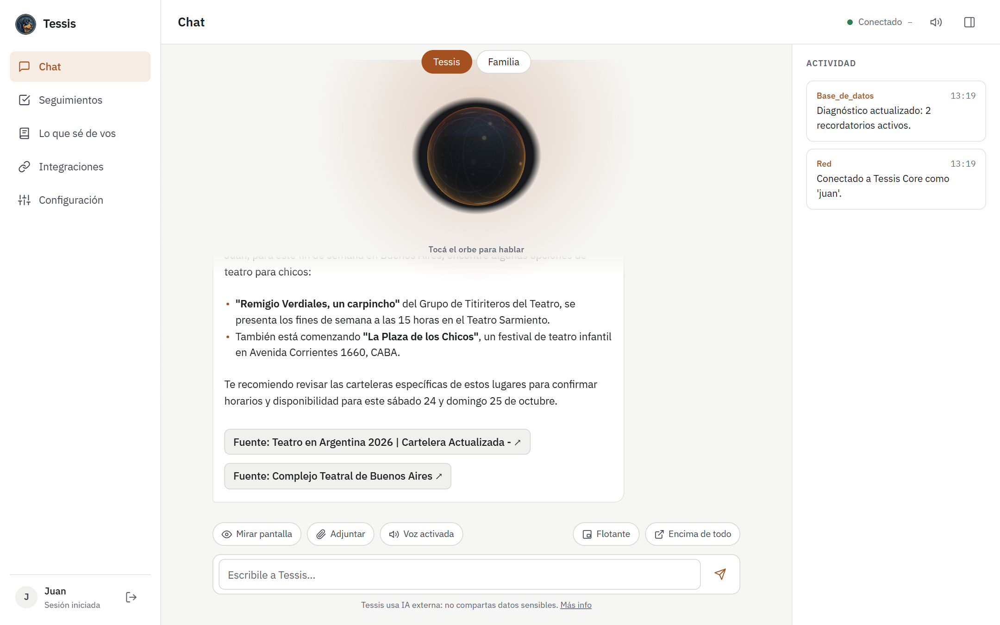

<p align="center">
  
</p>

<p align="center">
  
  
  
  
</p>

<p align="center">
  <a href="#-qué-es-tessis">Qué es</a> ·
  <a href="#-qué-puede-hacer">Qué puede hacer</a> ·
  <a href="manual/README.md">Manual de usuario</a> ·
  <a href="#-cómo-conseguirla">Cómo conseguirla</a> ·
  <a href="#-seguridad-y-transparencia">Seguridad</a> ·
  <a href="#-ayuda-y-soporte">Ayuda</a> ·
  <a href="#-apoyar-el-proyecto">Apoyar el proyecto</a>
</p>

---

## 🐾 Qué es Tessis

**Tessis es una asistente personal autónoma con IA: te conoce, entiende tu contexto y actúa por su cuenta.
Vive en tu propio servidor, así que tus datos son tuyos.**

Se adelanta a tu día: te avisa cuándo salir, te recuerda lo importante y te da la bienvenida cuando llegás.
Habla en español, por texto o por voz, y sirve para todo tu hogar.

Funciona **las 24 horas, todos los días**. Aunque el celular y la PC estén apagados, sigue atenta a tu agenda, a tus
recordatorios y a tus lugares para avisarte a tiempo. Se usa como una **app web (PWA)**: la instalás en el celular
o en la PC desde el navegador, con su ícono y sus notificaciones, sin pasar por las tiendas.

<p align="center">
  
  &nbsp;
  
  &nbsp;
  
</p>

> [!NOTE]
> Tessis se instala con una **licencia mensual**; ver [Cómo conseguirla](#-cómo-conseguirla).

---

## ✨ Qué puede hacer

| | |
|---|---|
| ⏱️ **Siempre activa** | Funciona todo el día en tu servidor, aunque apagues el celular y la PC. |
| 📲 **App en tu celular** | Se instala desde el navegador (PWA), con su ícono y sus notificaciones. |
| 💬 **Conversar y recordar** | Charla natural, por texto o por voz. Aprende de vos (personas, lugares, gustos, rutinas); podés ver, corregir o borrar lo que sabe. |
| 📅 **Organizar tu día** | Recordatorios a una hora, repetidos o al llegar a un lugar. Google Calendar, resumen de la mañana, plazos y vencimientos. |
| 🚗 **Avisarte cuándo salir** | Sigue el tránsito real para que llegues a horario. Al llegar al trabajo, te da la bienvenida con tu agenda. |
| 📍 **Lugares** | Dónde estoy, cómo llego, qué hay cerca. Guarda tus lugares y aprende tus rutinas. |
| 🔎 **Información real** | Búsquedas con fuentes, clima, dólar, acciones, cripto, análisis de acciones e informes en PDF. Si no sabe algo, lo busca o te lo dice: no inventa. |
| 📨 **Correo y archivos** | Lee tu Gmail (solo lectura) y tu Google Drive. También mira las fotos y capturas que le mostrás. |
| 🏠 **Para todo el hogar** | Una cuenta por persona, con mensajes y recordatorios entre ustedes: «decile a Ana que compre pan». |
| 💻 **Tu computadora** | Con el agente para Windows abre programas y mira tu pantalla cuando se lo pedís. También puede pensar con una **IA instalada en tu PC**. |
| 🔒 **Tus datos, en tu servidor** | Cada hogar tiene su propia instalación, con respaldo diario. Si querés, guarda además una copia cifrada en tu Drive. |

Todo esto, con capturas y ejemplos, está en el **[manual de usuario](manual/README.md)**.

---

## 🎬 Así se ve

<table>
  <tr>
    <td width="50%"><br><sub>«¿Cómo llego al trabajo?» — con el tránsito de ahora</sub></td>
    <td width="50%"><br><sub>«Analizame YPF» — datos reales e indicadores</sub></td>
  </tr>
  <tr>
    <td><br><sub>Mensajes y recordatorios entre los miembros del hogar</sub></td>
    <td><br><sub>En la computadora, con el panel de actividad</sub></td>
  </tr>
</table>

---

## 🚀 Cómo conseguirla

Tessis corre en un **servidor tuyo**: una máquina gratis de Oracle Cloud o de Google Cloud, o una computadora en
casa con Ubuntu.

1. **Comprá tu licencia** en **[Conseguir Tessis](https://licencias.tessis-ia.com/comprar)**. El primer
   mes cuesta **3 USD**; después, **5 USD por mes**. Se paga en **USDT o USDC por la red BNB Smart Chain**, y al
   pagar tu clave (`TESS-XXXX-XXXX-XXXX-XXXX`) aparece en la página.
2. **Creá tu servidor** con la guía de [Oracle Cloud](manual/01-instalacion.md) o la de
   [Google Cloud](manual/01b-instalacion-google.md). Al crear la máquina pegás un script de inicio con tu clave, y
   Tessis se instala sola. Si ya tenés un Ubuntu andando, alcanza con este comando:
   ```bash
   curl -fsSL https://licencias.tessis-ia.com/instalar.sh -o instalar.sh && bash instalar.sh
   ```
3. **Entrá a [Mi Tessis](https://licencias.tessis-ia.com/)** con tu clave: ahí ves la dirección de tu
   Tessis. La primera vez, creá tu cuenta con esa misma clave.

Tessis se mantiene sola: controla su licencia cada hora, instala las versiones nuevas de madrugada y te avisa unos
días antes de que venza la licencia.

> [!IMPORTANT]
> Para responder, Tessis usa **servicios de IA externos** (Groq, Google Gemini) con tus propias claves, que tienen
> opción gratis. Lo que escribís, adjuntás o mostrás de tu pantalla se procesa en esos servicios: **no compartas
> información sensible.**

**¿Cuánto cuesta la IA?** Groq y Gemini tienen planes gratis que, para el uso normal de un hogar, suelen alcanzar.
Si un día se llega al límite, Tessis lo dice y usa el otro servicio. Google Maps también tiene un crédito mensual
gratis. Lo que pagues a esos servicios, si pasás a un plan pago, es aparte de la licencia.

**¿Y si no me funciona?** Si en los primeros 7 días desde tu primera compra no lográs hacerla funcionar,
escribinos y te devolvemos el pago.

---

## 🔐 Seguridad y transparencia

- **El instalador es público:** es [`instalar.sh`](instalar.sh), en este repositorio. Podés leerlo antes de
  ejecutarlo y comprobar que es el mismo que se descarga desde la página de licencias:
  ```bash
  diff <(curl -fsSL https://licencias.tessis-ia.com/instalar.sh) <(curl -fsSL https://raw.githubusercontent.com/mcagariglio-star/Tessis-Asistente-Autonomo-IA/main/instalar.sh) && echo "Es el mismo"
  ```
- **Cada versión se verifica:** antes de instalar o actualizar, Tessis comprueba la huella (sha256) de lo que
  descargó. Si no coincide, no instala nada. Si una versión nueva no arranca bien, vuelve sola a la anterior.
- **Tus claves, cifradas:** las claves de IA y las autorizaciones de Google se guardan cifradas en tu servidor y
  no se vuelven a mostrar.
- **Qué recibimos nosotros:** solo el control de la licencia (tu clave, la versión y la dirección de tu Tessis,
  para mostrártela en Mi Tessis). Tus conversaciones, recuerdos, archivos y claves quedan en tu servidor y nunca
  pasan por nosotros. No tenemos acceso a tu servidor.

---

## 🛟 Ayuda y soporte

- **Dudas y sugerencias:** en [Discussions](https://github.com/mcagariglio-star/Tessis-Asistente-Autonomo-IA/discussions).
- **Errores:** en [Issues](https://github.com/mcagariglio-star/Tessis-Asistente-Autonomo-IA/issues), contando qué
  pasó y qué esperabas.
- **Pagos, licencias o algo privado:** a [mca.gariglio@gmail.com](mailto:mca.gariglio@gmail.com).

> [!CAUTION]
> Discussions e Issues son públicos: nunca pegues ahí tu clave de licencia, tus claves de IA ni datos personales.

---

## 💛 Apoyar el proyecto

Tessis es un proyecto independiente. Si te sirve y querés ayudar a que siga creciendo, podés aportar en cripto:

| Red | Dirección |
|---|---|
| **BNB Smart Chain (BEP20)** | `0xE7C0f00a914EcBc1C73E2175BA66af0e4003Fba3` |

> [!WARNING]
> Mandá **solo por la red BNB Smart Chain (BEP20)**: BNB o tokens BEP20 como USDT o USDC. Si lo enviás por otra red,
> el aporte se puede perder. Revisá la dirección antes de confirmar.

¡Gracias! 🙌

---

<p align="center">
  <sub>Este repositorio tiene la presentación, el manual y el instalador de Tessis. El código de Tessis es privado.<br>
  Contacto: <a href="mailto:mca.gariglio@gmail.com">mca.gariglio@gmail.com</a></sub>
</p>
