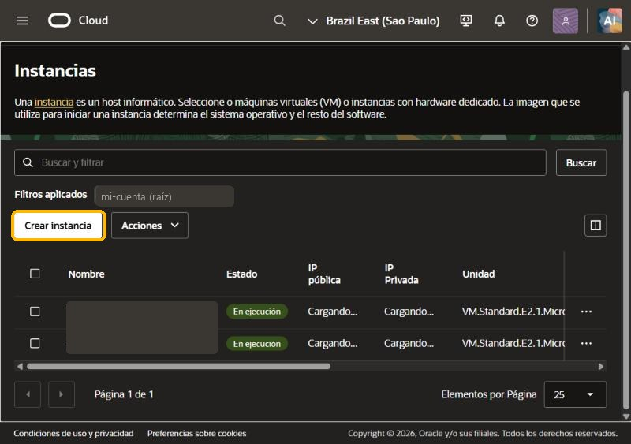
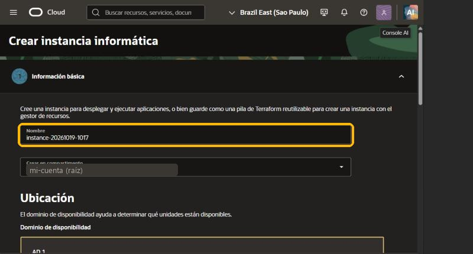
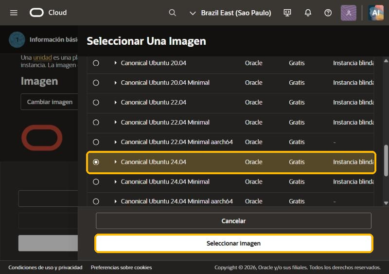
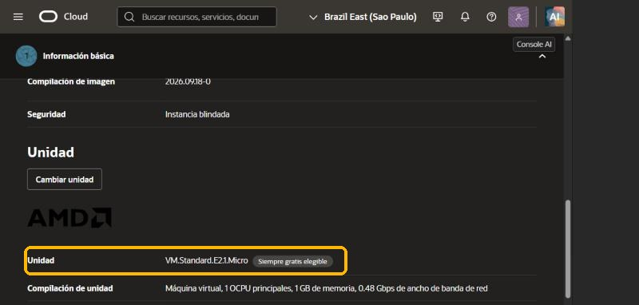
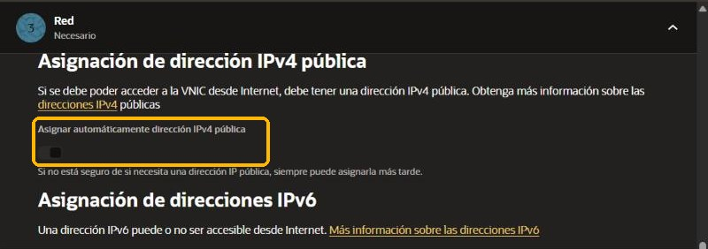
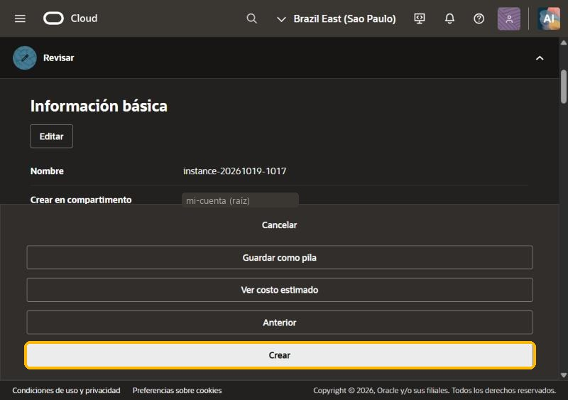
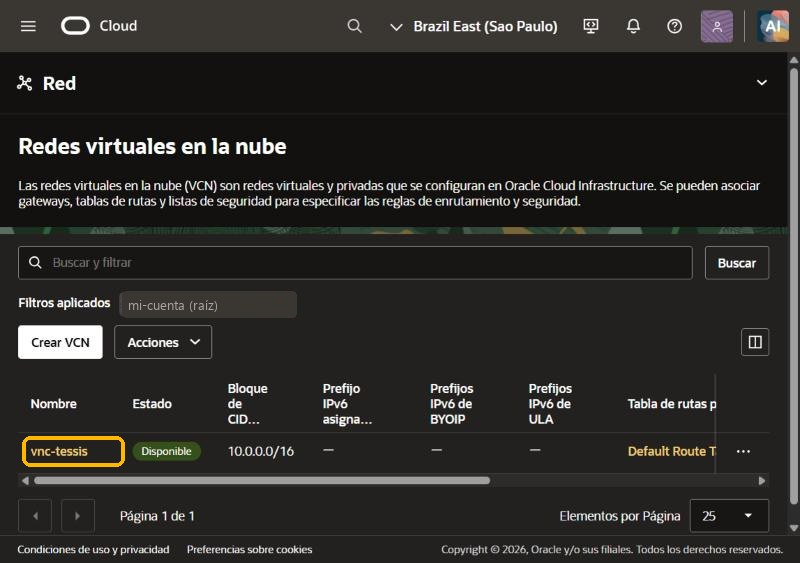
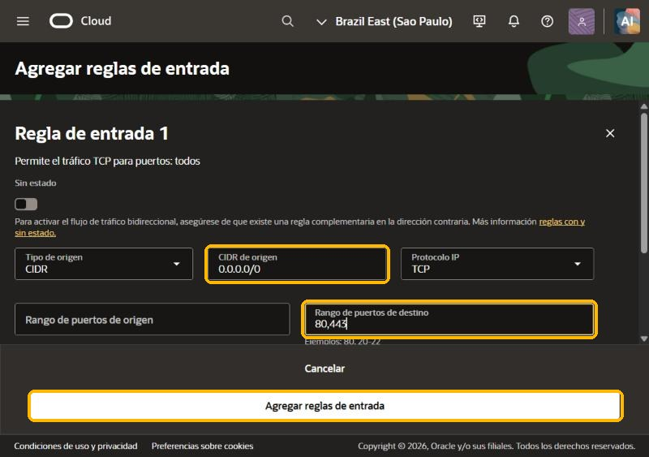

# 1 · Instalación

Tessis corre en un **servidor tuyo**. La forma más fácil, y gratis, es una máquina de **Oracle Cloud**: se crea
desde el navegador en unos 15 minutos. Después, Tessis se instala sola.

**Qué necesitás**
- Tu **clave de licencia** (`TESS-XXXX-XXXX-XXXX-XXXX`).
- Una cuenta de **Oracle Cloud** (gratis; pide una tarjeta de crédito solo para verificar tu identidad).
- 20 minutos.

---

## Paso 1 · Crear la cuenta de Oracle Cloud

Entrá a [signup.cloud.oracle.com](https://signup.cloud.oracle.com/) y completá tus datos.

> [!IMPORTANT]
> La **región** que elijas no se puede cambiar después: lo gratis existe solo en esa región. Elegí la más cercana con lugar:
> **Brazil East (Sao Paulo)**, **Brazil Southeast (Vinhedo)** o **Chile Central (Santiago)**.

Oracle acepta tarjetas de **crédito** a nombre del titular de la cuenta (suele rechazar débito, prepagas y
virtuales). Hace un cargo chico de verificación que después devuelve. Cuando llegue el mail «Your account is
ready», seguí.

---

## Paso 2 · Crear la máquina

En el menú **☰ → Recursos informáticos → Instancias**, tocá **Crear instancia**.



1. **Nombre:** `tessis`.

   

2. **Imagen:** tocá **Cambiar imagen**, elegí **Ubuntu** y marcá **Canonical Ubuntu 24.04** (la que no dice
   «Minimal»). Tocá **Seleccionar imagen**.

   

3. **Unidad:** tiene que quedar **VM.Standard.E2.1.Micro**, con la etiqueta «Siempre gratis elegible».

   

   > [!TIP]
   > Si tenés lugar, una **Ampere VM.Standard.A1.Flex** (1 procesador y 6 GB, también gratis) es mucho mejor.
   > Está en **Cambiar unidad → Ampere**. Casi siempre hay que reintentar varias veces para conseguirla.

4. **El script de inicio (lo más importante):** debajo de la unidad abrí **Opciones avanzadas → Gestión → Script
   de inicialización**, elegí **Pegar script cloud-init** y pegá esto, **cambiando la clave por la tuya**:

   ```bash
   #!/bin/bash
   curl -fsSL https://licencias.tessis-ia.com/instalar.sh -o /tmp/instalar.sh
   su - ubuntu -c "TESSIS_CLAVE=TESS-XXXX-XXXX-XXXX-XXXX bash /tmp/instalar.sh" > /var/log/tessis-instalar.log 2>&1
   ```

   Son 3 líneas y la primera es `#!/bin/bash`. Usá tu clave, la que recibiste por mail.

5. **Siguiente** → en **Seguridad** no cambies nada → **Siguiente**.
6. **Red:** en una cuenta nueva ya viene **Crear nueva red virtual en la nube** y **Crear nueva subred pública**.
   Bajá y fijate que **Asignar automáticamente dirección IPv4 pública** quede **encendido**.

   

7. **Claves SSH:** dejá **Generar un par de claves para mí** y descargá la clave privada. Sirve por si alguna
   vez hay que entrar a la máquina: guardala en un lugar seguro.
8. **Siguiente** → **Almacenamiento** sin cambios → **Siguiente** → **Crear**.

   

En uno o dos minutos la máquina pasa a **En ejecución**. A partir de ahí, Tessis empieza a instalarse sola.

---

## Paso 3 · Abrir los puertos de la web

Oracle bloquea todo por defecto: hay que permitir los puertos **80 y 443** (los de las páginas web).

1. Andá a **☰ → Red → Redes virtuales en la nube** y tocá tu red (empieza con `vcn-`).

   

2. Pestaña **Seguridad** → **Default Security List for …** → pestaña **Reglas de seguridad**.
3. **Agregar reglas de entrada**: **CIDR de origen** `0.0.0.0/0` y **Rango de puertos de destino** `80,443`. Tocá
   **Agregar reglas de entrada**.

   

---

## Paso 4 · Entrar a tu Tessis

La instalación tarda unos **10 minutos** desde que la máquina queda en ejecución.

**La dirección de tu Tessis** es la **IP pública** de tu máquina (la ves en **Instancias**, columna «IP pública»),
con **guiones** en lugar de puntos y terminada en **`.sslip.io`**. Por ejemplo, si la IP es `140.238.12.34`, tu
Tessis es **`https://140-238-12-34.sslip.io`**. Guardala en favoritos.

No hace falta que la armes a mano. La página donde compraste la licencia y **[Mi Tessis](https://licencias.tessis-ia.com/)**
(con tu clave) te muestran la dirección. Cuando está lista, te avisan y te dan un botón para abrirla.

1. Entrá a **[Mi Tessis](https://licencias.tessis-ia.com/)** y poné tu clave: vas a ver la dirección de
   tu Tessis y si ya está lista.
2. Abrí esa dirección, tocá **Crear la cuenta del titular** y usá **tu clave de licencia** como código de alta.

Listo: seguí con los [primeros pasos](02-primeros-pasos.md).

---

## Si algo no sale

| Qué pasa | Qué hacer |
|---|---|
| Al crear la máquina dice **«Capacidad insuficiente»** u **«Out of capacity»** | Oracle no tiene máquinas gratis libres en ese momento. Tenés tres opciones: reintentar más tarde (de noche o temprano suele haber lugar); pasar la cuenta a **Pay As You Go** (lo gratis sigue siendo gratis y te da prioridad); o usar el plan B, **[Google Cloud](01b-instalacion-google.md)**. |
| **«bootVolumeQuota… limit reached»** | Se llenaron los 200 GB gratis de disco: borrá discos de máquinas viejas en **Almacenamiento → Volúmenes de inicio**. |
| En Mi Tessis dice **«Todavía no responde»** después de media hora | Revisá el paso 3 (puertos 80 y 443). |
| La máquina no tiene IP pública | Faltó encender «Asignar automáticamente dirección IPv4 pública». Entrá a la instancia → Redes → la VNIC → Direcciones IP → editar → IP pública efímera. |

### ¿Ya tenés un servidor Ubuntu?

En cualquier Ubuntu 24.04 (en la nube o en una PC en casa), desde la terminal:

```bash
curl -fsSL https://licencias.tessis-ia.com/instalar.sh -o instalar.sh && bash instalar.sh
```

Te pide la clave y se encarga del resto.
