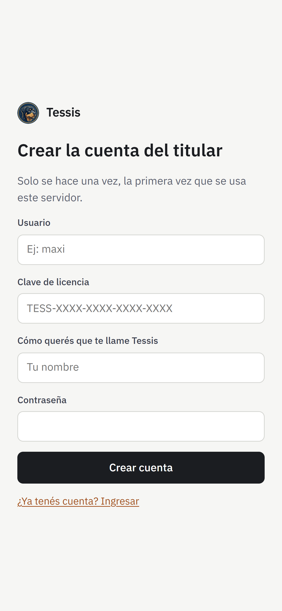
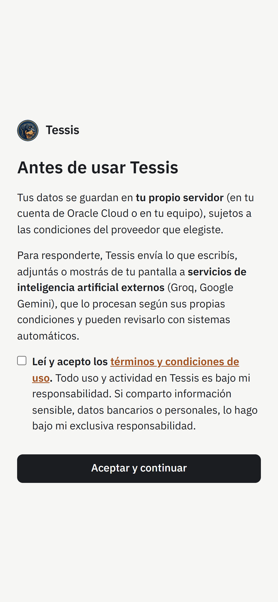

# 2 · Primeros pasos

## Crear tu cuenta

La primera vez que abrís tu Tessis, tocá **«¿Primera vez en este servidor? Crear la cuenta del titular»** y
completá:

- **Clave de licencia:** la misma con la que instalaste (`TESS-XXXX-XXXX-XXXX-XXXX`).
- **Usuario** y **contraseña**: los vas a usar para entrar desde el celular y la PC.
- **Cómo querés que te llame Tessis.**

Antes de empezar, Tessis te muestra cómo se usan tus datos. Leelo: lo que escribís y mostrás se procesa con
servicios de IA externos.

---

## Instalar la app en el celular

Tessis es una **app web (PWA)**: se instala desde el navegador, en el celular y en la PC, sin pasar por las tiendas.

- **Android (Chrome):** abrí tu Tessis → menú ⋮ → **Instalar app** (o «Agregar a la pantalla principal»).
- **iPhone (Safari):** abrí tu Tessis → botón **Compartir** → **Agregar a inicio**.

Queda con su ícono, a pantalla completa, y te puede mandar **notificaciones** (aceptá el permiso cuando lo pida).
Tessis trabaja en tu servidor las 24 horas: aunque cierres la app o apagues el celular, sigue atenta a tu agenda,
tus recordatorios y tus lugares, y te avisa con una notificación.

---

## Cargar tus claves de IA

Tessis piensa con servicios de IA que **vos elegís y pagás (o no)**. Los dos tienen una opción gratis que alcanza
para el uso de un hogar:

| Servicio | Dónde se saca la clave | Costo |
|---|---|---|
| **Groq** | [console.groq.com/keys](https://console.groq.com/keys) | Gratis con límite por minuto; pago por uso, muy barato |
| **Google Gemini** | [aistudio.google.com/apikey](https://aistudio.google.com/apikey) | Cuota gratis diaria; pago por uso |

En Tessis: **Configuración → IA**, pegá las claves y guardá. Con las dos, si una falla o llega a su límite, Tessis
sigue con la otra sin que lo notes.

Y dos claves más, para que las búsquedas y las rutas den datos reales:

| Servicio | Para qué | Dónde se saca la clave | Costo |
|---|---|---|---|
| **Tavily** o **Brave Search** (una de las dos) | Búsquedas en internet con fuentes | [app.tavily.com](https://app.tavily.com/) · [brave.com/search/api](https://brave.com/search/api/) | Gratis, sin tarjeta: Tavily da 1.000 búsquedas por mes; Brave, 5 USD de crédito por mes (unas 1.000 búsquedas) |
| **Google Maps** (opcional) | Rutas con tiempo y tránsito, avisos de cuándo salir, lugares cercanos | [Google Cloud → Credenciales](https://console.cloud.google.com/apis/credentials) (activar Directions, Places y Geocoding) | Crédito gratis mensual; pide cargar una tarjeta |

Opcional también: **SerpApi** ([serpapi.com](https://serpapi.com/), gratis 250 búsquedas por mes) para buscar
**vuelos** con precios reales.

Si cargás las dos de búsqueda, Tessis usa Tavily y, si falla, Brave. Sin ninguna, no puede buscar en internet. Sin Google Maps, las rutas salen como un enlace a Maps, sin tiempos.

> [!TIP]
> ¿No querés usar servicios externos para charlar? Con el [agente para Windows](09-pc.md) Tessis puede pensar con
> una **IA instalada en tu PC**.

---

## Conectar Google

En **Integraciones → Vincular con Google** autorizás Calendar, Drive y Gmail (solo lectura). Cada persona del hogar
vincula su propia cuenta.

> [!NOTE]
> Durante la prueba piloto, Google solo deja conectar cuentas autorizadas: mandale al administrador el Gmail de
> cada persona del hogar que va a usar Calendar, Drive o Gmail.

Todo lo demás (notificaciones, horarios de silencio, voz, tema, PIN, respaldo) está en
**[Configuración](02b-configuracion.md)**. Después seguí con [Charlar y hablar](03-charlar.md).
