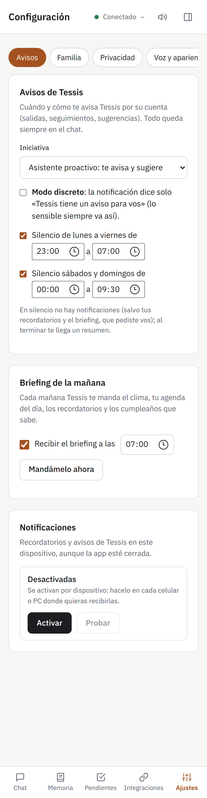
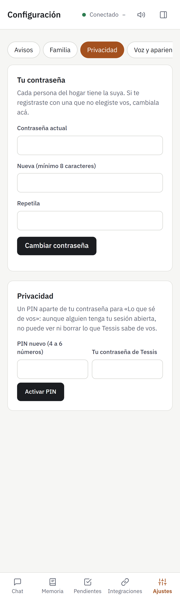
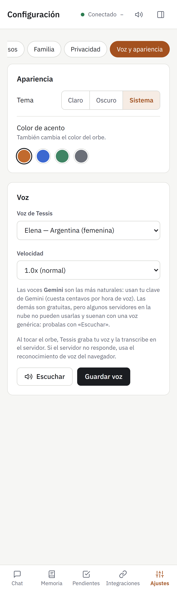
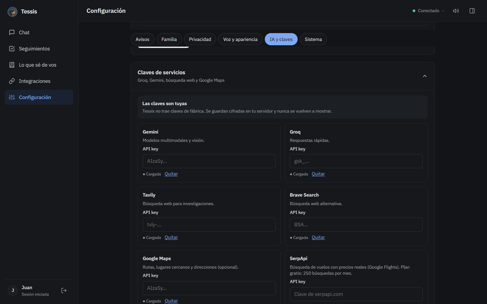

# 2b · Configuración de tu Tessis

Todo se ajusta desde **Ajustes** (en el celular, abajo a la derecha) o **Configuración** (en la PC, en el menú de la
izquierda). Está ordenado en pestañas:

| Pestaña | Qué se configura |
|---|---|
| [Avisos](#-avisos) | Cuánto se adelanta Tessis, horarios de silencio, resumen de la mañana, notificaciones |
| [Familia](#-familia) | Invitar a los de tu casa, contraseñas, bajas |
| [Privacidad](#-privacidad) | Tu contraseña y el PIN de «Lo que sé de vos» |
| [Voz y apariencia](#-voz-y-apariencia) | Tema claro u oscuro, color, voz y velocidad |
| [IA y claves](#-ia-y-claves) | Las claves de Groq, Gemini, búsqueda y Maps; la IA de tu PC |
| [Sistema](#-sistema) | Respaldo en tu Google Drive, ubicación, estado del servidor |

Y aparte, en **Integraciones**: Google (Calendar, Drive, Gmail), tu PC y la ubicación con OwnTracks.

---

## 🔔 Avisos

- **Iniciativa:** cuánto se adelanta Tessis por su cuenta.
  - **Asistente proactivo** (recomendado): te avisa cuándo salir, te recuerda plazos y te sugiere cosas.
  - **Autónomo controlado:** además ejecuta las reglas automáticas que le diste.
  - **Observador:** aprende de tu rutina, pero no te avisa nada por su cuenta.
- **Modo discreto:** la notificación dice solo «Tessis tiene un aviso para vos», sin el contenido. Lo sensible
  siempre llega así.
- **Silencio:** horarios sin notificaciones, uno para días hábiles y otro para el fin de semana. Tus recordatorios y
  el resumen de la mañana llegan igual (los pediste vos), y al terminar el silencio te llega un resumen de lo demás.
- **Resumen de la mañana:** elegí la hora y cada día te llega el clima, tu agenda, los recordatorios y los
  cumpleaños que Tessis sabe. Con **Mandámelo ahora** lo probás.
- **Notificaciones:** se activan **en cada dispositivo** (celular y PC por separado). Tocá **Activar**, aceptá el
  permiso y probalo con **Probar**.

> [!TIP]
> En el iPhone, las notificaciones funcionan solo si Tessis está instalada en la pantalla de inicio
> ([ver cómo](02-primeros-pasos.md#instalar-la-app-en-el-celular)).

---

## 🏠 Familia

- **Invitar:** poné el nombre y el vínculo («Laura», «pareja») y tocá **Crear invitación**. Compartile el enlace:
  vale 48 horas y una sola vez, y la persona elige su usuario y su propia contraseña.
- Para cada miembro, el titular puede:
  - **Contraseña:** generarle un enlace para que elija una nueva si se la olvidó.
  - **Dar de baja:** deja de poder entrar (sus datos quedan guardados).
  - **Borrar:** la borra a ella **y todos sus datos**. No se puede deshacer.
- **Bloquear** (cada uno, para sí): esa persona no te puede mandar mensajes ni recordatorios por Tessis.

Más sobre el hogar en [El hogar](08-hogar.md).

---

## 🔒 Privacidad

- **Tu contraseña:** cambiala cuando quieras. Al cambiarla se cierran las sesiones abiertas en tus otros
  dispositivos.
- **PIN de privacidad:** un número de 4 a 6 cifras, aparte de tu contraseña, para entrar a **«Lo que sé de vos»**.
  Aunque alguien tenga tu sesión abierta en tu celular, no puede ver ni borrar lo que Tessis sabe de vos.

---

## 🎨 Voz y apariencia

- **Tema:** claro, oscuro o el del sistema (cambia solo con tu celular).
- **Color de acento:** naranja, azul, verde o gris. También cambia el color del orbe.
- **Voz de Tessis** y **velocidad:** elegí y probá con **Escuchar**; después **Guardar voz**.
  - Las voces **Gemini** son las más naturales: usan tu clave de Gemini (cuestan centavos por hora de voz).
  - Las demás son gratis.

---

## 🧠 IA y claves

- **Claves de servicios** (desplegá el recuadro): pegá cada clave y guardá. Se guardan **cifradas** en tu servidor y
  nunca se vuelven a mostrar: solo ves «● Cargada». Con **Quitar** la borrás.

  | Clave | Para qué | ¿Hace falta? |
  |---|---|---|
  | **Groq** | Pensar y conversar (rápido) | Sí, Groq o Gemini (mejor las dos) |
  | **Gemini** | Pensar, mirar imágenes, voz natural | Sí, Groq o Gemini (mejor las dos) |
  | **Tavily** o **Brave** | Buscar en internet | Recomendada |
  | **Google Maps** | Rutas con tránsito, avisos de salida, lugares cercanos | Opcional |
  | **SerpApi** | Buscar vuelos con precios | Opcional |

  Dónde sacar cada una, en [Primeros pasos](02-primeros-pasos.md#cargar-tus-claves-de-ia).
- **Modelos de IA:** qué modelo usa Tessis para cada tarea y en qué orden (Groq primero y Gemini si falla, o al
  revés). Lo que viene elegido es lo recomendado.
- **IA local (tu PC):** si instalaste la IA en tu computadora, elegí si Tessis piensa **primero con tu PC** cuando
  está prendida (ver [Tu PC e IA local](09-pc.md)).

Las claves del titular las usa todo el hogar: los demás no necesitan cargar nada.

---

## 🔧 Sistema

- **Respaldo en Google Drive:** una copia diaria de todo Tessis, **cifrada**, en tu Drive (carpeta «Tessis -
  respaldos», guarda los últimos 7 días). Al activarlo te muestra un **código de recuperación**: anotalo y guardalo
  bien, porque es la única forma de abrir los respaldos. Si tu servidor se pierde, con ese código se recupera todo.
- **Ubicación:** cada cuánto este dispositivo manda su ubicación (cada 3 minutos es lo recomendado) y cuánto tiempo
  se guarda tu recorrido (7 días). Tus lugares guardados, las llegadas y salidas y tus rutinas no se borran.
- **Estado del sistema:** si la base de datos funciona y cuántos recordatorios hay activos.

---

## 🔗 Integraciones

- **Google:** vinculá Calendar, Drive y Gmail (solo lectura) con tu cuenta. Cada persona del hogar vincula la suya.
- **Dispositivos vinculados:** conectá tu PC con el [agente para Windows](09-pc.md).
- **OwnTracks:** para que Tessis sepa cuándo llegás o te vas de tus lugares aunque no tengas la app abierta. Seguí
  los 3 pasos de la pantalla **desde el celular**.
