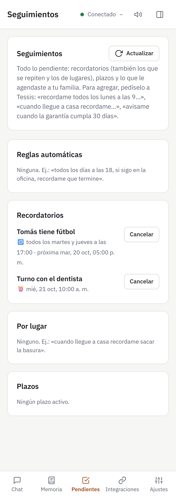

# 4 · Recordatorios y agenda

## Recordatorios

| Le decís | Qué hace |
|---|---|
| «Recordame en 20 minutos sacar la ropa» | un aviso en 20 minutos |
| «Mañana a las 9 llamar al contador» | un aviso mañana a las 9 |
| «Todos los martes y jueves a las 17, Tomás tiene fútbol» | un aviso que se repite |
| «Todos los meses el 10, pagar la tarjeta» | uno mensual |
| «Cuando llegue a casa, recordame sacar la basura» | un aviso **al llegar** a un lugar guardado |
| «Mañana a las 10 tengo dentista en Av. Cabildo 2000. Avisame cuándo salir» | sigue el tránsito y te avisa a tiempo |

El aviso te llega como **notificación** al celular y a la PC, aunque no tengas Tessis abierta. Si se repite, Tessis
te avisa también un rato antes. Y si el servidor estuvo apagado a esa hora, te llega apenas vuelve, avisándote del
atraso.

Todo lo pendiente está en **Pendientes**: recordatorios, los que se repiten, los de lugares, los plazos y lo que le
agendaste a tu familia. Desde ahí los podés cancelar.

## Google Calendar

Si vinculaste Google (**Integraciones**), Tessis ve tu agenda y crea eventos: «¿qué tengo el jueves?», «agendame
una reunión el lunes a las 15». Si el evento tiene una dirección, te avisa cuándo salir según el tránsito.

Sin Google, igual se agenda: queda como recordatorio de Tessis.

## Resumen de la mañana

En **Configuración → Avisos** elegís una hora y cada mañana te llega un resumen: la agenda del día, el clima, los
recordatorios y los mails importantes.

## Plazos y reglas

- **Plazos:** «avisame cuando la garantía cumpla 30 días», «el seguro vence el 15 de diciembre». Te avisa antes de
  cada vencimiento.
- **Reglas automáticas:** «todos los días a las 18, si sigo en la oficina, recordame que termine», «si llueve cuando
  salgo, avisale a Laura». Las ves y las pausás en **Pendientes**.
