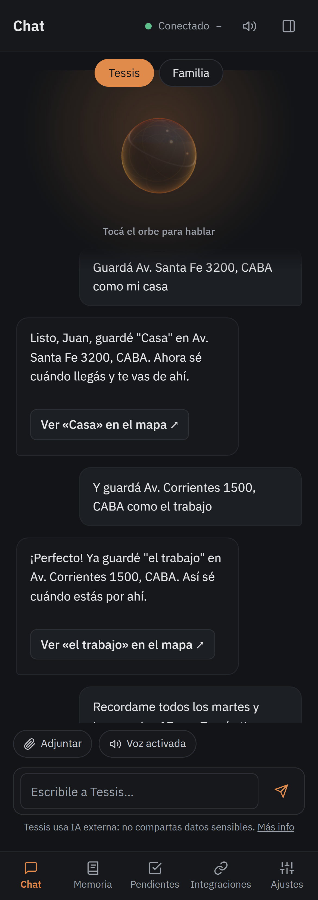

# 5 · Lugares y salidas

Para que Tessis sepa dónde estás, el celular le comparte la ubicación: desde la app (con el permiso de ubicación)
o, mejor, con **OwnTracks**, que la manda aunque la app esté cerrada (**Integraciones → Conectar OwnTracks**).

## Lugares guardados

«Guardá Av. Santa Fe 3200 como mi casa», «guardá esta ubicación como el trabajo», «la casa de mis viejos es en…».
Con los lugares guardados Tessis:

- sabe cuándo llegás y cuándo te vas, y **aprende tus rutinas**;
- te da la **bienvenida** al llegar: en el trabajo, con lo que tenés agendado; en casa, con lo que quedó pendiente;
- te hace los **recordatorios por lugar** («cuando llegue a casa…»).

Los ves, los mirás en el mapa o los olvidás en **Memoria → Mis lugares**.

## Rutas y tránsito

| Le decís | Qué hace |
|---|---|
| «¿Cómo llego desde casa al trabajo?» | distancia y tiempo con el tránsito de ahora, y botón para navegar |
| «Mandame la ruta al supermercado» | la ruta desde donde estás |
| «¿Dónde estoy?» | tu ubicación, o el lugar guardado en el que estás |
| «¿Hay una farmacia cerca?» | lugares cercanos, abiertos y con dirección |

## Avisos para salir a tiempo

Cuando un recordatorio o un evento tiene una dirección, Tessis sigue el tránsito desde un rato antes y te avisa
**cuándo salir** para llegar a horario. Si el tránsito cambia, el aviso se corre.

> [!NOTE]
> Las rutas con tiempo y tránsito, los lugares cercanos y los avisos de salida usan **Google Maps**, con tu clave
> (ver [Primeros pasos](02-primeros-pasos.md)). Sin ella, Tessis te da el enlace a Maps.
