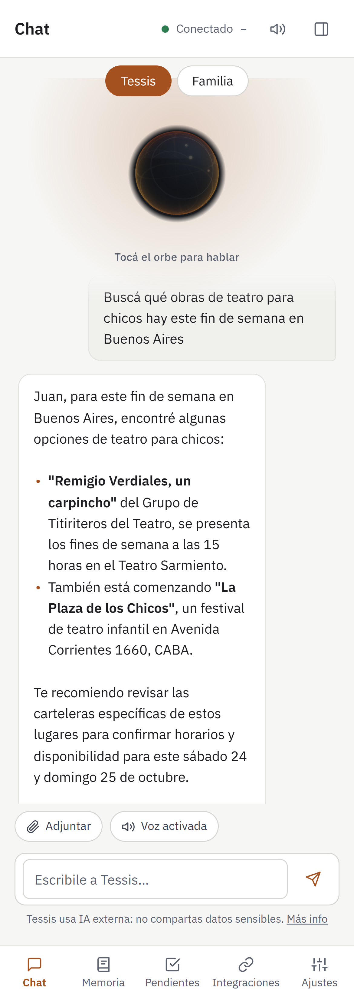
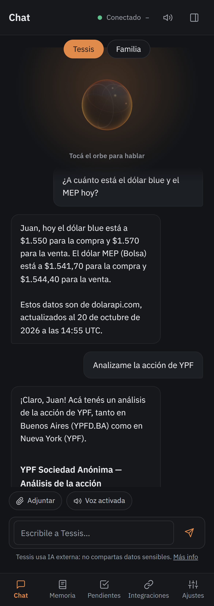

# 6 · Información

## Búsquedas en internet

«Buscá qué obras para chicos hay este fin de semana», «¿quién ganó el partido?», «averiguá el horario del banco».
Tessis busca, lee las páginas y te contesta **con las fuentes**, para que puedas ver de dónde sale cada dato.

## Clima

«¿Cómo va a estar el clima mañana?», «¿llueve el sábado en Mar del Plata?», «¿llevo paraguas?».

## Dólar, acciones y cripto

Con datos reales del mercado:

| Le decís | Qué te da |
|---|---|
| «¿A cuánto está el dólar blue y el MEP?» | oficial, blue, MEP y CCL, compra y venta |
| «¿Cómo está Galicia?», «¿y Apple?» | la cotización de una acción o un CEDEAR |
| «Analizame YPF» | un análisis completo: tendencia, indicadores, fundamentales y opinión de analistas |
| «¿A cuánto está el bitcoin?» | cripto en dólares |

  
  &nbsp;
  

> [!WARNING]
> Es información para que analices, **no una recomendación de inversión**.

## Informes en PDF

«Haceme un informe de 10 páginas sobre energía solar para casas». Tessis investiga en varias fuentes, arma el
informe por secciones y te lo deja para descargar (y, si querés, en tu Google Drive). Los informes largos se arman en
segundo plano y te avisa cuando están listos.
