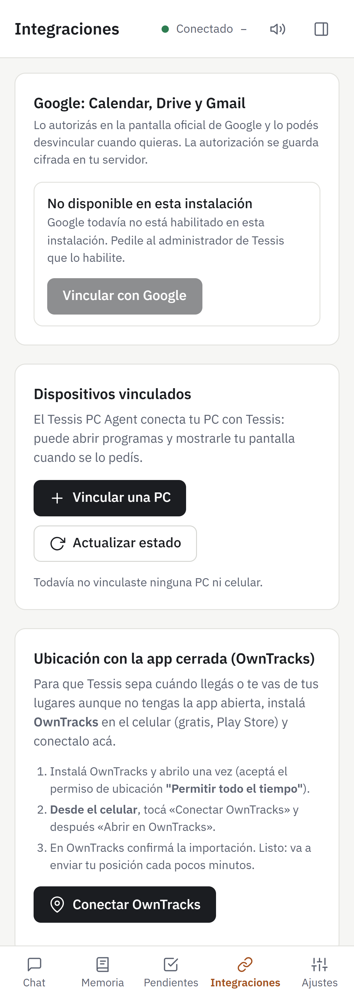

# 7 · Correo, Drive e imágenes

Primero vinculá tu cuenta en **Integraciones → Vincular con Google** (cada persona del hogar, la suya).

## Gmail (solo lectura)

| Le decís | Qué hace |
|---|---|
| «¿Me llegó algo del banco?» | busca en tu Gmail |
| «¿Tengo mails sin leer importantes?» | te muestra los últimos |
| «Resumime el mail de la escuela» | lo lee y te lo resume |

Tessis **solo lee**: no manda, no borra, no marca como leído. Los mails importantes también aparecen en el resumen
de la mañana.

## Google Drive

«Buscá en mi Drive el contrato del alquiler», «leeme la planilla de gastos», «subí el informe a mi Drive».

## Imágenes y capturas

Con **Adjuntar** le mandás una foto o captura y le escribís qué querés que haga. Desde la PC, con el agente, también
le podés decir «mirá mi pantalla» (ver [Tu PC](09-pc.md)).

> [!IMPORTANT]
> Los mails, archivos e imágenes que le pedís mirar los procesa una IA externa. No compartas información sensible.
