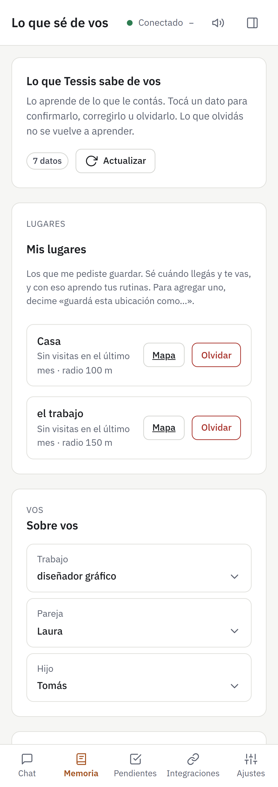
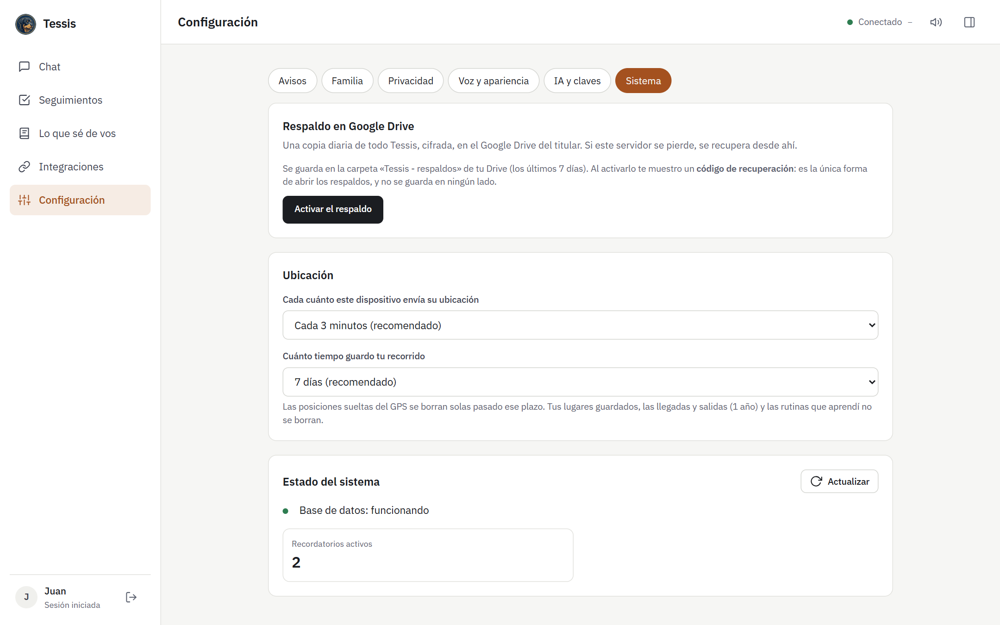

# 10 · Privacidad y ajustes

## Dónde están tus datos

- **En tu servidor.** Las charlas, la memoria, los recordatorios, los lugares y la configuración se guardan en la
  base de datos de tu propia instalación. Cada persona del hogar ve solo lo suyo.
- **Las claves** de Groq, Gemini y Google se guardan **cifradas**.
- **Los servicios de IA externos** (Groq, Gemini) reciben lo que escribís, adjuntás o mostrás de tu pantalla para
  poder responder, y lo procesan según sus propias condiciones. **No compartas información sensible.**

Los términos y condiciones completos están en tu Tessis (`https://<tu-tessis>/terminos`) y en el enlace del aviso
de uso.

---

## Lo que Tessis sabe de vos

En **Lo que sé de vos** ves todo lo que Tessis aprendió: personas, lugares, gustos, rutinas y datos. Podés
corregir o borrar cualquier cosa, y si borrás algo, no lo vuelve a aprender de la misma charla.

> [!TIP]
> En **Configuración → Privacidad** podés poner un **PIN** aparte de tu contraseña: aunque alguien tenga tu sesión
> abierta, no puede ver ni borrar lo que Tessis sabe de vos.

Lo que Tessis marca como sensible (salud, dinero, documentos) **nunca lo dice en voz alta**.

---

## Respaldos

- **Todos los días** se guarda una copia de la base en tu servidor.
- **Respaldo en tu Google Drive (opcional):** en **Configuración → Sistema → Respaldo**. La copia sube **cifrada** y
  solo se abre con un **código de recuperación** que se te muestra una única vez: guardalo en un lugar seguro.

---

## Actualizaciones y licencia

Tessis se actualiza sola, de madrugada. Si una versión nueva no arranca, vuelve sola a la anterior. Si tu licencia
está por vencer o tiene algún problema, el titular ve un aviso arriba en la app.

---

## Preguntas frecuentes

**¿Tessis me escucha todo el tiempo?**
No. Solo procesa lo que le escribís o le decís cuando tocás el micrófono.

**¿Puede leer mis mails o mandar mails por mí?**
Puede **leer** tu Gmail si lo vinculás, para buscar y resumir. No manda, no borra y no marca mails.

**¿Ve mi pantalla sin avisarme?**
No. Solo cuando se lo pedís («mirá mi pantalla»), y solo si tu PC tiene el agente con ese permiso.

**¿Qué pasa si se cae internet o el servidor?**
Los recordatorios que vencieron con el servidor apagado salen apenas vuelve, avisando el atraso.

**¿Cuánto cuesta?**
El servidor de Oracle y las claves de IA tienen opciones gratis que alcanzan para un hogar. La licencia de Tessis
es gratuita durante la prueba piloto.

**¿Cómo borro todo?**
El titular puede borrar a un miembro y todos sus datos desde **Configuración → Familia**. Para borrar todo, se borra
el servidor.
